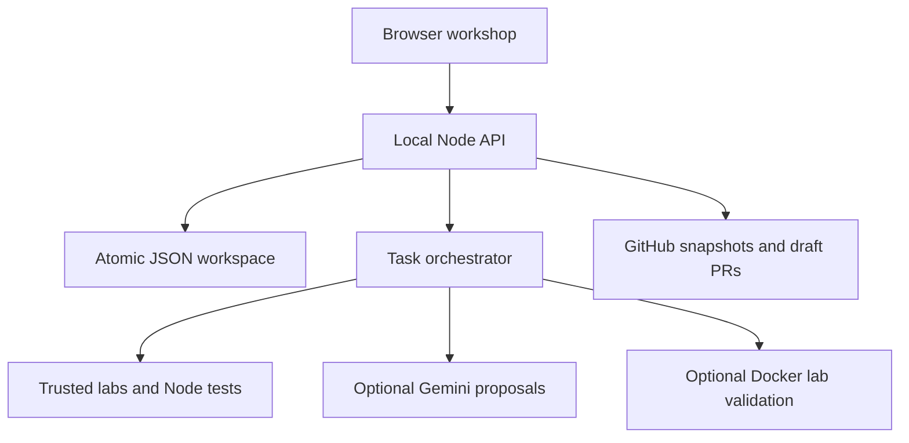
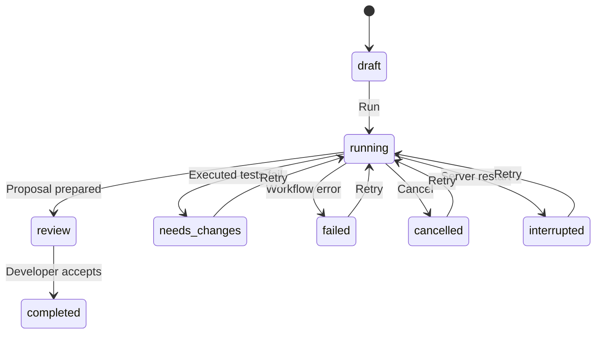

# Architecture

Kodumi is a same-origin browser application and Node HTTP server. The frontend uses ES modules, native dialogs, CSS variables, SVG characters, and event delegation. The backend uses only Node built-ins. There is no bundler or framework installation.

## Request and execution flow

The browser polls state only while a task is running, the document is visible, and no dialog is open. API responses contain feature availability flags, not server credentials. No external fonts, analytics, CDNs, or frontend packages are required.

## Task state machine

One task runs at a time. Each run begins again from its immutable source snapshot, clears its prior run output, and records a fresh event history. A restart marks in-flight tasks interrupted rather than claiming success. An approval is allowed only from review. Publishing is a separate action and never merges code.

| Stage | Guided lab | Gemini task |
| --- | --- | --- |
| Scout | Reads the fixture, runs original tests, stores failing baseline | Reads the available snapshot; lab baselines run when applicable |
| Atlas | Loads the bundled diagnosis and repair plan | Calls Gemini for diagnosis, plan, and edits |
| Forge | Prepares the shipped patch | Validates existing paths and prepares model-proposed file replacements |
| Pixel | Runs the bundled regression suite on the repair | Runs supported lab validation, or explicitly reports skipped validation |
| Review | Developer inspects evidence and accepts locally | Same; GitHub tasks can then publish an explicitly confirmed draft PR |

Characters are UI representations of these stages. There are no independent collaborating models, hidden reasoning traces, AST dependency graphs, vector search, or semantic project memory in v1.

## Data model

- **Repository:** identity, kind, name, source files, import metadata, base commit/tree, and partial-snapshot flag.
- **Task:** title, description, mode, stage, status, diagnosis, evidence, plan, file changes, baseline/validation results, events, approval, and optional PR URL.
- **Settings:** theme and reduced-motion preference.

State is stored in `.kodumi/workspace.json` by default. Writes are serialized and use a temporary file plus atomic rename. This is suitable for one local process, not a distributed database or multiple concurrent servers. Changing `KODUMI_DATA_DIR` selects a separate workspace.

## Patch representation

Each change contains an existing file path, original content, and proposed content. Originals are retained. The UI compares complete files; the exporter creates full-file unified hunks accepted by `git apply`, including missing-final-newline markers. The importer never downloads repository executables onto a command path or installs dependencies.

## Integration boundaries

Gemini requests use the REST `generateContent` endpoint with JSON output. Runtime validation checks the shape, limits, file membership, and changed contents. Provider keys are sent in headers. Provider output is untrusted and is never evaluated as JavaScript by the server.

GitHub calls target only `api.github.com`, with owner/name input validation. Snapshots are pinned to commit and tree SHA values. Draft PR creation requires a locally accepted task, explicit confirmation, an unchanged base branch, and a configured token. A separate branch is created; the base reference is never updated. Repository snapshots are immutable and each import receives its own local ID.

The app does not claim to automatically verify imported repositories. Source may contain undetected sensitive data: hidden-file/path exclusion is only a filter, not a secret scanner.
